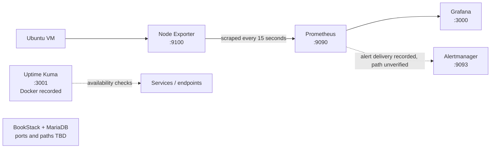

# Fed-SysOps-Mastery

## Ubuntu Monitoring Lab

Version-controlled operating notes and sanitized configuration examples for the user's Ubuntu VM monitoring lab. The lab is a learning environment and must remain distinct from Datasphir's production monitoring design.

> **Evidence status:** This package is based on the project memory and supplied documentation. The VM was not accessible for live inspection during preparation. “Deployed” means recorded as deployed in that history; it does not mean currently running or healthy. Configuration files under this repository are examples/templates unless explicitly identified otherwise.

## Components recorded in project memory

| Component | Recorded state | Version recorded | Documented port | Notes |
|---|---|---:|---:|---|
| Ubuntu VM | Base platform established | Not recorded | — | Current OS release and VM identity not verified. |
| Prometheus | Deployed/configured; initial scrape pipeline verified historically | 3.15.0 | 9090 | Recorded scrape interval 15s; targets included Prometheus and Node Exporter. |
| Node Exporter | Deployed/configured as systemd service | 1.12.1 | 9100 | Recorded unit name `prometheus-node-exporter`; confirm actual unit/package on VM. |
| Grafana | Deployed as systemd service; Prometheus data source recorded | Not recorded | 3000 | Data source URL recorded as `http://localhost:9090`; saved panel data still needed validation. |
| Uptime Kuma | Docker deployment recorded | Not recorded | 3001 | Container name recorded as `uptime-kuma`; current container/runtime state not verified. |
| Alertmanager | Deployment work recorded; notification pipeline unverified | Not recorded | 9093 | Treat receiver and routing setup as incomplete until verified. |
| BookStack + MariaDB | Deployed | Not recorded | Not recorded | Preserve the existing BookStack shelf/books. Actual service paths and ports were not in evidence. |

Ports are documented defaults/recorded values, not a current socket or firewall audit. See [the evidence register](docs/operations/evidence-register.md).

## Architecture



This is a reconstruction from project notes, not a live topology export. The separate company target design (Proxmox discovery, Blackbox Exporter, Loki, centralized monitoring) is not represented as implemented in this VM.

## Repository map

```text
.
├── README.md
├── CHANGELOG.md
├── .gitignore
├── .gitlab-ci.yml
├── docs/
│   ├── architecture/overview.md
│   ├── deployment/current-state.md
│   ├── operations/evidence-register.md
│   ├── operations/routine-maintenance.md
│   ├── troubleshooting/runbook.md
│   └── bookstack-linking.md
├── prometheus/prometheus.yml.example
├── prometheus/rules/README.md
├── alertmanager/alertmanager.yml.example
└── systemd/README.md
```

No live configuration export was available. Do not replace active VM files with templates without first comparing and backing up the real files.

## Safe use

1. Review the evidence register and confirm the live VM state.
2. Copy an example to a separate working file and replace placeholders locally.
3. Keep real credentials, private addresses, private keys, runtime databases, and backups out of Git.
4. Validate changes with the documented application tools before deployment.
5. Record the change, validation result, and rollback point in BookStack and this repository.

See [deployment notes](docs/deployment/current-state.md), [operations](docs/operations/routine-maintenance.md), and [troubleshooting](docs/troubleshooting/runbook.md).

## GitLab CI

The pipeline checks YAML syntax for the CI file and committed configuration examples, plus trailing whitespace in Markdown. It does not deploy to the VM or prove application-level validity. Add protected deployment jobs only after a deliberate design for secrets, runner trust, backups, and rollback.

## BookStack relationship

Keep your existing `01 Infrastructure`, `03 Docker`, and `04 Monitoring` structure. Link this repository's overview and relevant component pages from the current monitoring books; details in [BookStack linking](docs/bookstack-linking.md). Do not create a competing BookStack hierarchy.

